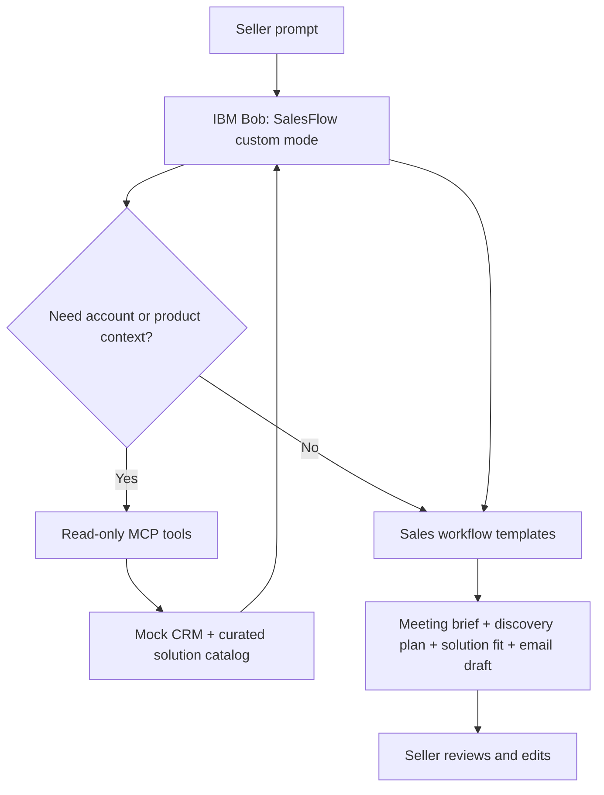

# SalesFlow — IBM Bob Sales Enablement Mode

**IBM Bob-a-thon | Track 2: Integration — Extend Bob & Other**  
**Status:** Hackathon MVP specification · **Date:** October 29, 2026

## Overview

**SalesFlow** is a dedicated custom mode for IBM Bob that helps enterprise technical sellers prepare for customer meetings, qualify opportunities, recommend relevant solution areas, respond to objections, and draft follow-up materials.

SalesFlow is **one focused Bob mode**—**not** a multiagent orchestrator. It follows a repeatable sales workflow and can use approved, read-only MCP tools to retrieve fictional CRM records and curated product facts.

## Problem

Technical sellers often prepare for a single customer conversation by consulting CRM records, notes, product documentation, and competitor research separately. The result can be slow preparation, inconsistent discovery, and poorly grounded recommendations.

**Goal:** Turn a single sales request into an accurate, editable, source-backed meeting package without requiring the seller to stitch together multiple tools.

## Example

**Seller prompt:**

> I'm meeting Acme Healthcare tomorrow about replacing aging storage. They need high availability, but I don't know their capacity or budget. Prepare a discovery plan.

**SalesFlow response:**

1. **Account brief:** Known account context, with sources and clearly flagged unknowns.
2. **Discovery plan:** 6–10 tailored SPIN questions about workloads, capacity, recovery, security, budgets, and decision-makers.
3. **Solution fit:** Relevant capabilities from an approved demo catalog, with evidence and caveats.
4. **Objection handling:** Likely concerns and suggested responses, without inventing competitor claims.
5. **Follow-up package:** Meeting agenda, action checklist, and editable email draft.

## Features and scope

| Priority | Capability | Description |
| --- | --- | --- |
| P0 | SalesFlow Bob mode | Reusable sales-specific instructions, workflows, and response formats. |
| P0 | Discovery preparation | Meeting objectives, missing-information questions, SPIN discovery prompts. |
| P0 | Solution positioning | Map confirmed requirements to curated product facts; cite evidence. |
| P0 | Sales deliverables | Meeting brief, objection-handling guidance, and follow-up draft. |
| P0 | Grounding and review | Separate facts from assumptions; require seller approval before use. |
| P1 | Mock CRM MCP | Read fictional accounts, opportunity notes, and meeting history. |
| P1 | Catalog lookup | Search approved demo solution data through read-only MCP tools. |
| P1 | Comparison | Compare relevant solution options using documented facts only. |

**Out of scope for the MVP:** multiagent delegation, automatic CRM modifications, sending customer emails, live internal IBM pricing, and access to production customer records.

## Proposed architecture



### Illustrative MCP tool contract

| Tool | Purpose |
| --- | --- |
| `get_account(account_id)` | Retrieve fictional organization details. |
| `get_opportunity(opportunity_id)` | Return sales stage, requirements, and open questions. |
| `get_interactions(account_id)` | Read seeded call notes and prior interactions. |
| `search_solution_catalog(query)` | Find verified demo capabilities and source references. |

These are **proposed tools**, not existing Bob commands. Tool availability depends on what the team implements and on hackathon permissions.

## Suggested repository structure

```text
salesflow/
├── README.md
├── .bob/                    # Bob custom mode configuration (confirm version-specific path)
├── prompts/                 # Demonstration prompts and output templates
├── data/
│   ├── accounts.json        # Synthetic accounts and opportunities
│   └── catalog.json         # Curated, sourced demo product information
├── mcp-server/              # Optional read-only integration
├── tests/                   # Golden scenarios and grounding checks
└── docs/
    ├── PRD.docx
    └── demo-script.md
```

## Implementation plan

1. **Mode:** Define SalesFlow's purpose, workflow, response structure, and safety rules inside IBM Bob.
2. **Demo data:** Seed one fictional customer, a relevant opportunity, interaction notes, and a small curated product catalog.
3. **Core flow:** Generate a full meeting preparation package from a single prompt.
4. **Integration:** Add read-only MCP endpoints if supported by the event environment.
5. **Validation:** Test missing data, unsupported claims, source attribution, and repeatability.
6. **Submission:** Package runnable code, prompt usage examples, team feedback, and a five-minute demo video.

> **Setup note:** This repository description is a product blueprint, not an assertion that runnable mode files or an MCP server have already been created. Add specific install/run commands once the team chooses its Bob version, MCP runtime, and implementation language.

## Acceptance criteria

- Team member can select SalesFlow and run the seeded scenario.
- Produces a meeting objective, at least six relevant discovery questions, objections, and next actions.
- Separates verified data, hypotheses, and unknowns.
- Recommendations reference the curated catalog rather than inventing capabilities or prices.
- Does **not** send messages or alter customer systems automatically.
- If MCP is implemented, demonstrates at least two successful read-only calls.
- Provides a repeatable five-minute demo.

## Five-minute demo storyboard

| Time | Demo moment |
| --- | --- |
| 0:00–0:35 | Show the fragmented meeting-prep problem. |
| 0:35–1:10 | Select SalesFlow mode and provide the customer request. |
| 1:10–2:00 | Review account context and missing-information prompts. |
| 2:00–3:10 | Show grounded discovery questions and solution fit. |
| 3:10–4:15 | Generate meeting brief, objections, and follow-up draft. |
| 4:15–5:00 | Demonstrate tool evidence, safeguards, and measurable value. |

## Suggested responsibilities

- **Bob mode and UX:** Mode configuration, prompt flow, output templates.
- **Data and MCP:** Synthetic account records, catalog, optional read-only MCP server.
- **QA and demo:** Scenario tests, source checking, video, submission packaging.

## Security and limitations

Use fictional customer data only unless explicitly authorized otherwise. Do not store credentials in the repository. Keep tools least-privilege and read-only. Treat retrieved content as evidence, not as instructions. A human seller must review every customer-facing draft. Do not claim current pricing or product support without a verified source.

## Required hackathon deliverables

- Problem statement and solution summary
- Readable, executable source submitted as ZIP
- Five-minute solution video
- Bob prompts and examples of usage
- Team member feedback on Bob

## Documentation

- [IBM Bob custom modes](https://bob.ibm.com/docs/ide/configuration/custom-modes)
- [IBM Bob MCP integration](https://bob.ibm.com/docs/ide/configuration/mcp/mcp-in-bob)

See the accompanying **SalesFlow PRD** for detailed requirements, validation metrics, risks, and decisions.
