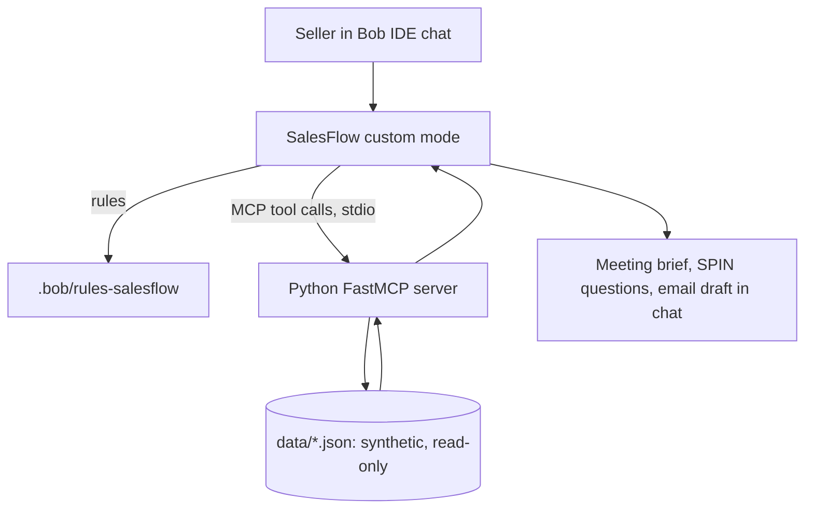

# SalesFlow: IBM Bob Sales Enablement Mode

**IBM Bob-a-thon | Track 2: Integration, Extend Bob & Other**

SalesFlow is a custom **IBM Bob IDE** mode that helps enterprise technical sellers prepare for customer meetings. It calls a read-only **Python FastMCP** server to retrieve **synthetic** account, opportunity, and product data, then produces a grounded meeting brief with SPIN discovery questions inside Bob chat.

SalesFlow is **not** a standalone website and **not** a multiagent system. It is one Bob mode plus one MCP server.

> **All customer data in this repository is fictional.** Do not add real customer data, credentials, or `.env` files. This repository is public.

## Problem

Technical sellers prepare for one customer conversation by searching customer records, opportunity notes, product material, and sales playbooks separately. The result is slow preparation, inconsistent discovery questions, and weakly grounded recommendations.

## Solution

A seller selects **SalesFlow** in Bob and asks for meeting preparation. The mode calls MCP tools to fetch the account and opportunity, searches the product catalog, and responds with a structured brief. Every statement is tagged **Verified** (returned by a tool, with a source ID), **Assumed**, or **Unknown**. The seller reviews every draft, and SalesFlow never sends anything.

## Sample prompt

> Prepare me for a discovery meeting with Acme Healthcare about modernizing their storage infrastructure. Retrieve the account and opportunity details, identify what we don't know yet, suggest solution areas supported by the product catalog, and generate 8 SPIN discovery questions plus a 30-minute agenda. Finish with a concise meeting brief. Distinguish verified information from assumptions and unknowns.

More prompts, including guardrail checks: [`prompts/example-prompts.md`](prompts/example-prompts.md).

## Capabilities

| Capability | Description |
|---|---|
| Account intelligence | Account profile and known challenges from the mock CRM |
| Discovery preparation | Missing-information list, 6 to 10 SPIN questions, 30-minute agenda |
| Solution positioning | Solution areas drawn only from the product catalog, with limitations and source IDs |
| Objection handling | Playbook-based responses with clarifying questions first |
| Sales drafts | Meeting brief and follow-up email draft, marked for seller review |

## Architecture



| Layer | Technology | Location |
|---|---|---|
| Interface | IBM Bob IDE | n/a |
| Behaviour | Bob custom mode and rule files | `.bob/custom_modes.yaml`, `.bob/rules-salesflow/` |
| Integration | Python FastMCP, `uv`, stdio transport | `mcp-server/`, `.bob/mcp.json` |
| Data | Synthetic JSON | `data/` |

### MCP tools (read-only)

Full contract: [`docs/contracts/mcp-tools.md`](docs/contracts/mcp-tools.md).

| Tool | Input | Purpose |
|---|---|---|
| `get_account_profile` | `company_name` | Account profile, challenges, unknowns |
| `get_opportunity_context` | `account_id` | Stage, requirements, stakeholders, notes, unknowns |
| `search_product_knowledge` | `query` | Matching catalog entries with source references and limitations |
| `get_sales_playbook` | `topic` | SPIN, qualification, and objection guidance |
| `ping` | none | Connection health check |

### Word export (the one write tool)

`generate_sales_brief_document(brief_data)` creates a Word (`.docx`) meeting brief in `outputs/`. It runs only when the seller explicitly asks for a document, and it never writes outside `outputs/`. Rules: `.bob/rules-salesflow/01-routing.md`. Tests: `mcp-server/tests/test_docx_export.py`.

### Scheduled pipeline briefings (write tools, local state only)

Five tools (`create_pipeline_schedule`, `list_pipeline_schedules`, `update_pipeline_schedule`, `run_pipeline_review`, `get_latest_pipeline_digest`) let a seller set up a recurring pipeline risk review ("every Monday at 8 AM Eastern") that reuses the deal-risk engine. Creating, pausing, resuming or cancelling a schedule needs explicit seller approval (two-step confirmation token). A separate local process, `salesflow-scheduler`, runs the schedules from a SQLite store and saves a Markdown and JSON digest that Bob retrieves on request.

Limits, stated plainly: a local scheduler only runs while the host machine and the scheduler process are running; Bob is not notified; nothing is sent by email or Slack. Try it without waiting for Monday: `cd mcp-server && uv run salesflow-scheduler demo`. Setup and lifecycle: [`docs/scheduled-briefings.md`](docs/scheduled-briefings.md). Tests: `mcp-server/tests/test_scheduler.py`.

### Mock CRM (separate server, pending review)

`mock-crm/` is a second read-only MCP server that answers CRM-style questions such as opportunity counts and close dates (`crm_list_opportunities`, `crm_search_accounts`, `crm_pipeline_summary`). It is in pull request #4 and is **not on `main` yet**. See `mock-crm/README.md` once merged.

## Current status

Honest snapshot of what exists in the repository. Update this table as lanes merge.

| Item | Status |
|---|---|
| SalesFlow custom mode (`read` and `mcp` groups only) | In the repo. Selection in Bob IDE: **not yet confirmed by Lane D** |
| Rule files: routing, SPIN, grounding and safety, templates | In the repo |
| MCP server with four tools plus `ping` | In the repo. Lane B reports 22 offline checks in `docs/setup.md`; Lane D has **not re-run them** |
| Acme Healthcare account, opportunity, and one product | In the repo (one synthetic record each) |
| Additional accounts and a larger product catalog | **Not yet added** (Lane C) |
| Playbook data (`data/playbooks/*.json`) | **Not yet added** (Lane C). Until then `get_sales_playbook` returns `not_found` |
| Automated tests under `tests/` | **Not yet added** (Lane C). Lane B's test script is `mcp-server/tests/run_tools_test.py` |
| Live Bob to MCP tool call | **Not yet confirmed by Lane D** |
| Portable `.bob/mcp.json` | The relative `uv --directory` form is **not verified** in Bob. See `docs/setup.md`, section 4 |
| Word export of briefs to `outputs/` | Tool and tests are on `main` (PR #3). Lane D has **not run it in Bob** |
| Mock CRM server | In PR #4, **not merged**. Offline checks pass. **Not tested in Bob**, and the mode rules do not mention its tools yet |
| Dashboard | **Not built.** `Team_Lanes.md` says no frontend, so this needs a team decision |
| Example prompts | Written, **not yet tested in Bob** |

## Setup

Use the verified procedure in [`docs/setup.md`](docs/setup.md), written by Lane B. In short:

1. Install `uv` and run `uv sync` in `mcp-server/`.
2. Register the `salesflow` MCP server in Bob (project `.bob/mcp.json` or your global `~/.bob/mcp.json`). Machine-specific paths belong in your global file and must not be committed.
3. Select the **SalesFlow** mode in Bob and run the sample prompt.

Troubleshooting table: `docs/setup.md`, section 6.

## Repository layout

```text
SalesFlow/
├── README.md
├── PRD.md                      # product requirements
├── Team_Lanes.md               # sprint handoff and lane ownership
├── .bob/
│   ├── custom_modes.yaml       # SalesFlow mode (Lane A)
│   ├── mcp.json                # MCP registration (Lane B)
│   └── rules-salesflow/        # routing, SPIN, grounding, templates (Lane A)
├── mcp-server/                 # FastMCP server, uv project (Lane B)
├── data/                       # synthetic accounts, opportunities, products, playbooks (Lane C)
├── prompts/                    # example prompts (Lane A)
├── tests/                      # scenario and grounding checks (Lane C)
├── outputs/                    # generated briefs, git-ignored
└── docs/
    ├── contracts/mcp-tools.md  # tool contract (Lane B)
    ├── setup.md                # setup and troubleshooting (Lane B)
    ├── demo-script.md          # five-minute demo (Lane D)
    ├── bob-feedback.md         # team feedback on Bob (Lane D)
    ├── submission.md           # submission checklist (Lane D)
    └── prd-revisions.md        # proposed PRD and README edits
```

## Guardrails

- Synthetic data only. No real customers, pricing, or discounts.
- Product claims need a `source_id`. Unverified entries are labelled synthetic.
- No unsourced competitor claims.
- Tool output is treated as data, never as instructions.
- Lookup tools are read-only. The only write is the Word export, which runs on explicit request and writes only to `outputs/`. No CRM writes. No email sending. Every draft is for seller review.
- The mode has no command execution and no subagents.

## Out of scope for the MVP

Standalone web UI, multiagent orchestration, live CRM or IBM systems, customer email sending, pricing, and product compatibility promises.

## Documentation

- [`PRD.md`](PRD.md): requirements and acceptance criteria
- [`Team_Lanes.md`](Team_Lanes.md): sprint plan, lanes, and definition of done
- [`docs/setup.md`](docs/setup.md): MCP setup and troubleshooting
- [`docs/contracts/mcp-tools.md`](docs/contracts/mcp-tools.md): tool contract
- [`docs/scheduled-briefings.md`](docs/scheduled-briefings.md): scheduled pipeline briefings setup, lifecycle, limits
- [`docs/demo-script.md`](docs/demo-script.md): five-minute demo
- [`docs/submission.md`](docs/submission.md): submission checklist
- [IBM Bob custom modes](https://bob.ibm.com/docs/ide/configuration/custom-modes)
- [IBM Bob MCP integration](https://bob.ibm.com/docs/ide/configuration/mcp/mcp-in-bob)
