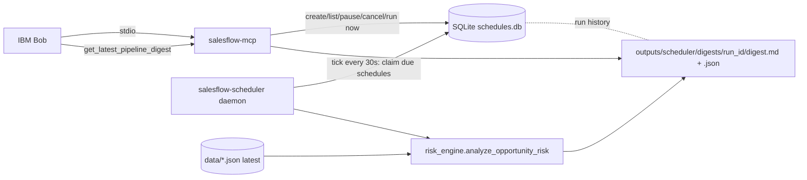

# Scheduled Pipeline Briefings (Feature 4)

Sellers can ask Bob for a recurring pipeline risk review, for example: "Every Monday at 8 AM Eastern, analyze my active deals and prepare a risk briefing." A local scheduler runs the existing deal-risk engine on that cadence and stores a digest that Bob retrieves on request.

Tool contract: [`contracts/mcp-tools.md`](contracts/mcp-tools.md) (tools 6-10). Sample output: [`samples/pipeline_digest_sample.md`](samples/pipeline_digest_sample.md) (synthetic data).

## Read this first: what this does and does not do

- **A local scheduler only runs while its host environment is running.** If the laptop is asleep or off, or the scheduler process is stopped, nothing runs. This is not a cloud service.
- **Bob is not notified.** Bob has no documented way to receive background pushes from an MCP server, so none is claimed. The digest is stored on disk; the seller asks Bob "get my latest pipeline digest" (or opens the Markdown file).
- **No message is ever sent.** No email, Slack or other notification is implemented. The `Notifier` hook in `scheduler.py` is an unused extension point (see "Optional notifications").
- **The MCP server is not the scheduler.** Bob starts and stops the stdio MCP server with its session, so recurring work must not depend on it. The scheduler is a separate process (`salesflow-scheduler`). Both share one SQLite file. Schedules can be created, paused and read through Bob even when the scheduler is stopped; they simply will not fire until it runs.
- Data is synthetic. Risk scores are heuristic prioritisation, not predictions.

## Architecture



| Module | Role |
|---|---|
| `schedule_spec.py` | Validates cadence/time/timezone; computes next run (DST-safe) |
| `schedule_store.py` | SQLite store: schedules, run history, audit events, heartbeat, atomic claim, confirmation tokens |
| `pipeline_review.py` | Reads latest CRM, calls the Feature 1 risk engine, builds/ranks the digest, renders Markdown |
| `scheduler.py` | Executes runs; APScheduler daemon; CLI (`run`, `tick`, `demo`, `status`) |
| `server.py` | The five MCP tools |

APScheduler 3.11 (`BlockingScheduler`, in-memory) is used only as a reliable 30-second ticker. **SQLite is the source of truth** for what is scheduled and when, so a restart loses nothing. Next-run times are computed in `schedule_spec.py` rather than by APScheduler's cron trigger so DST behaviour is explicit and tested.

## Setup

```bash
cd <repo>/mcp-server
uv sync                              # installs apscheduler + tzdata (pinned in uv.lock)
```

State lives in `<repo>/outputs/scheduler/` (git-ignored, directory mode 0700, database mode 0600). Override with an absolute path in `SALESFLOW_SCHEDULER_DIR`. The scheduler and the MCP server must see the same directory and the same `SALESFLOW_DATA_DIR` (default `<repo>/data`).

## Try it now (demo mode, no waiting until Monday)

```bash
cd <repo>/mcp-server
uv run salesflow-scheduler demo          # creates a Monday 8 AM ET schedule, makes it due now, runs it via the real scheduler path
uv run salesflow-scheduler demo --keep   # same, but leave the schedule active
```

Running the command is the seller's explicit authorization for that demo schedule. Without `--keep` it is cancelled afterwards. The output prints the digest paths. Then ask Bob: "Get my latest pipeline digest."

Demo through Bob alone (no terminal): ask "Run a pipeline review now." Bob calls `run_pipeline_review`, then `get_latest_pipeline_digest`.

## Seller workflow in Bob

1. "Every Monday at 8 AM Eastern, analyze my active deals and prepare a risk briefing."
2. Bob calls `create_pipeline_schedule` **without** a token. Nothing is created. Bob shows the preview ("Weekly on Mon at 08:00 America/New_York", scope, limitation) and asks you to confirm.
3. You approve. Bob repeats the same call with the single-use `confirmation_token`. The schedule is created and the next run time is shown in both Eastern and UTC.
4. Start the scheduler (below). `list_pipeline_schedules` reports whether a scheduler process has checked in recently.
5. Later: "Show my latest pipeline briefing", "pause the Monday review", "cancel it". Pause/resume/cancel use the same two-step confirmation.

## Lifecycle

### Start the scheduler

Foreground (simplest; stop with Ctrl+C or SIGTERM):

```bash
cd <repo>/mcp-server
uv run salesflow-scheduler run
```

Check state any time:

```bash
uv run salesflow-scheduler status
```

### Keep it running across logins (macOS, optional)

Create `~/Library/LaunchAgents/com.salesflow.scheduler.plist` (adjust the two paths; `which uv` for the first):

```xml
<?xml version="1.0" encoding="UTF-8"?>
<!DOCTYPE plist PUBLIC "-//Apple//DTD PLIST 1.0//EN" "http://www.apple.com/DTDs/PropertyList-1.0.dtd">
<plist version="1.0"><dict>
  <key>Label</key><string>com.salesflow.scheduler</string>
  <key>ProgramArguments</key><array>
    <string>/path/to/uv</string><string>run</string><string>--directory</string>
    <string>/path/to/SalesFlow/mcp-server</string><string>salesflow-scheduler</string><string>run</string>
  </array>
  <key>RunAtLoad</key><true/>
  <key>KeepAlive</key><true/>
  <key>StandardErrorPath</key><string>/tmp/salesflow-scheduler.log</string>
</dict></plist>
```

```bash
launchctl load ~/Library/LaunchAgents/com.salesflow.scheduler.plist     # start
launchctl unload ~/Library/LaunchAgents/com.salesflow.scheduler.plist   # stop
```

Alternative with no resident process: run `uv run salesflow-scheduler tick` from cron/launchd every few minutes. It executes whatever is due once and exits.

### Restart, sleep and missed runs

- **Restart:** the daemon re-reads SQLite, marks any run left "running" by a crash as `failed` (`interrupted`), and continues. Schedules, history and next-run times persist.
- **Computer was off or asleep at the scheduled time:** when the scheduler next ticks it runs the most recent missed occurrence only if it is at most 6 hours old (`SALESFLOW_MISFIRE_GRACE_SECONDS` to change). Older ones are recorded in history as `skipped` (`missed`) rather than running a stale briefing. Several missed occurrences collapse into one run with `missed_occurrences` set. Nothing is silently dropped.
- **Pause then resume:** the next run is recomputed from the resume time; no backlog is replayed.
- **Cancel:** permanent; history and digests remain.
- **Stop:** Ctrl+C / SIGTERM shuts down cleanly. Uninstall by cancelling schedules and unloading the launch agent; delete `outputs/scheduler/` to remove all state.

### Time zones and daylight saving

Schedules store local wall-clock time plus an IANA zone (default `America/New_York`). "8:00 AM Eastern" stays 8:00 AM local across both DST changes (13:00 UTC in winter, 12:00 UTC in summer). A time that does not exist on the spring-forward day runs at the shifted wall-clock time that day; an ambiguous time on the fall-back day runs once, at its first occurrence.

### Duplicate-run protection

Claiming due work is one SQLite `BEGIN IMMEDIATE` transaction that also advances the next run, and a unique index on (schedule, occurrence) blocks a second run of the same occurrence even if two scheduler processes race. A test runs six concurrent tickers and asserts exactly one run.

### Failures

A run that cannot read CRM data is recorded as `failed` (`crm_unavailable` / `crm_invalid`) with a user-safe message, an audit event, and a log line on stderr. The schedule stays active and tries again at the next occurrence; `last_successful_run` is preserved. `get_latest_pipeline_digest` returns the last good digest together with `newer_unsuccessful_run`, so a broken schedule is visible. Logs and stored errors contain no file paths or CRM content.

## What is stored

| Where | What |
|---|---|
| `schedules.db` (SQLite) | schedules, run history, audit events (create/pause/resume/cancel), scheduler heartbeat, short-lived confirmation tokens |
| `digests/<run_id>/digest.json` and `digest.md` | the digest, written atomically |

The digest contains CRM-derived deal names, values and risk evidence (synthetic here). With real data, treat the directory as sensitive.

## Scheduled analysis

At each run, in order: read `opportunities.json` and `accounts.json` fresh; take active opportunities (stage not starting with "Closed"), optionally limited to one seller; call `analyze_opportunity_risk` for each (the Feature 1 engine, unchanged); flag Medium and High risk (score >= 2); rank by score, then value, then id; attach evidence and recommended actions from the engine; list missing fields as Unknown (not scored); store JSON and Markdown; record the result.

## Seller authorization

`create_pipeline_schedule` and `update_pipeline_schedule` are two-step. The first call never changes anything and returns a preview plus a token bound to the exact parameters. The change happens only when the call is repeated with that token (single use, 10 minutes). A token cannot be reused, cannot authorize different parameters, and cannot be guessed. This is a guardrail that makes unapproved changes impossible by accident and requires Bob to surface the preview; Bob's own approval prompt and the rules in `.bob/rules-salesflow/01-routing.md` instruct it to obtain the seller's explicit approval between the two calls. A model that wrongly reuses a token it was just handed would still be limited to the one action that token covers.

`run_pipeline_review` creates no schedule and sends nothing, so it needs no token. It does write a digest and a history row.

## Optional notifications (not implemented)

`scheduler.Notifier` is a Protocol with one method, `notify(summary, markdown_path)`. `execute_run` calls it only if an instance is passed in, and its failure never fails the run. Nothing constructs one, and no email or Slack code exists. To add one later: put credentials in environment variables or a secrets manager (never in code or the database), require explicit seller configuration and per-schedule opt-in, send a summary/link the seller approved, use TLS with certificate validation, and use IBM-approved channels.

## Tests

```bash
cd <repo>/mcp-server
uv run python tests/test_scheduler.py     # 156 checks, includes a real scheduler subprocess and restart
```

Covers: schedule creation and validation; SQLite persistence and permissions; next-run calculation; DST (spring-forward gap, fall-back overlap, offset change); repeated execution; pause/resume/cancel; restart recovery and interrupted runs; missed-run policy; missing/malformed CRM data; duplicate-run protection (including 6 concurrent tickers); failure logging and error hygiene; the authorization-token gate; the five MCP tools; demo mode; and a scheduler process running with no MCP server attached. Tests use temp directories and never touch `data/` or `outputs/`. Existing suites remain green.

## Known limitations

- Runs only while the host and scheduler process are running (see top).
- Single machine, single SQLite file; no multi-host coordination.
- Weekly/daily cadences only; no monthly or cron expressions.
- The seller scope is a free-text match on the CRM `seller` field; there is no user identity or access control in this MVP.
- Risk scoring uses the Feature 1 engine's current-date handling: the review date is passed in explicitly (local date in the schedule's zone), so overdue/upcoming checks follow the run date.
